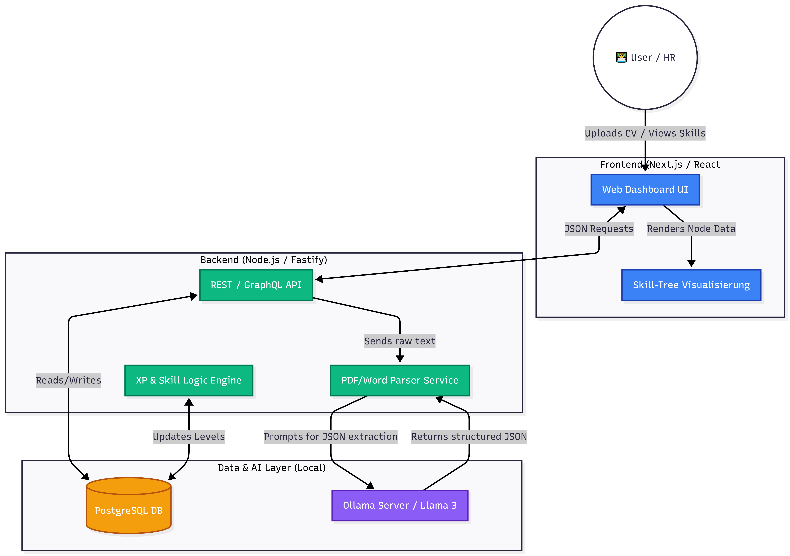
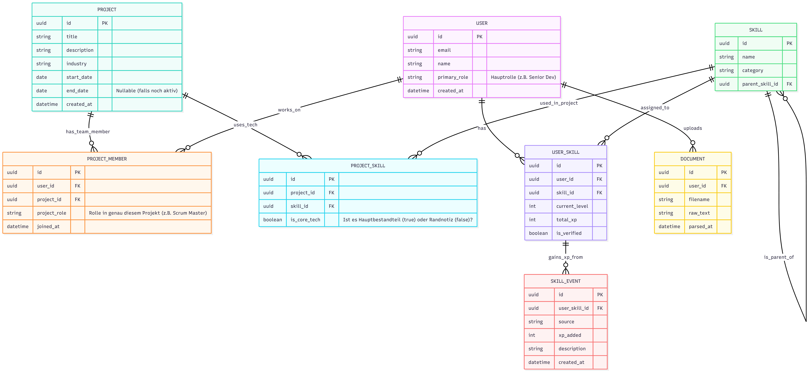

# 🏗️ ArborStack - System & Database Architecture

This document describes the technical infrastructure and data model of ArborStack. The system is modular, "Privacy-First" (self-hosted), and designed for event-driven growth.

---

## 1. High-Level System Architecture

The architecture strictly separates the frontend from the backend and integrates local AI services as independent containers within the same Docker network. This guarantees performance and absolute data sovereignty.

  
   
  <em>Figure 1: The modular container architecture of ArborStack.</em>

### Core Components:
* **Frontend (Next.js / React Flow):** The interactive dashboard and graph visualization. Communicates exclusively with the backend via a stateless API.
* **Backend (Node.js / Fastify):** The central logic engine. Handles API requests, calculates XP levels, and orchestrates the PDF parsing process.
* **Local AI Layer (Ollama / Llama 3):** A local inference server that translates unstructured resumes into structured JSON data (skills) via prompting. Data never leaves the internal company network.
* **Database (PostgreSQL):** The persistent storage layer. Uses Prisma as an ORM for type-safe and fast database queries.

---

## 2. Database Schema (Entity-Relationship)

The relational schema is designed to enable complex, graph-like queries (e.g., *"Find a developer with React skill > Level 20 who has previously worked in the role of 'Tech Lead'"*).

  
   
  <em>Figure 2: The expanded ER diagram including project and role mapping.</em>

### Key Tables & Relations:
* **`USER` & `SKILL` (Core):** The foundational building blocks. A user has many skills (`USER_SKILL`). Skills have parent IDs to visually build the skill tree (e.g., Web Development -> JavaScript -> React).
* **`SKILL_EVENT` (The Audit Log):** Every time a skill "levels up", the reason is stored here (e.g., *"+50 XP: GitHub PR merged"*, *"+1000 XP: Resume imported"*). This is essential for traceability and B2B compliance.
* **`PROJECT`, `PROJECT_MEMBER` & `PROJECT_SKILL` (The Matrix):**
  * An employee can have *different* roles across different projects (e.g., Backend Dev in Project A, Scrum Master in Project B). This history is tracked in `PROJECT_MEMBER`.
  * The `PROJECT_SKILL` table stores the tech stack of a project. When a milestone is reached, all members receive XP for these specific skills.

---

## 3. Data Flow (Core Use Cases)

To understand the architecture in action, here are the two most important data flows:

### Use Case A: The "Cold Start" (PDF Import)
1. HR or the employee uploads a PDF (resume).
2. Fastify extracts the raw text on the server (e.g., via `pdf-parse`).
3. The text is sent to the local **Ollama container** with the system prompt: *"Extract all tech skills and years of experience as JSON"*.
4. The backend validates the JSON, calculates the base XP, and creates initial `USER_SKILL` and `SKILL_EVENT` (Source: "PDF_IMPORT") entries in the PostgreSQL database.

### Use Case B: Passive Leveling (Webhooks)
1. GitHub sends a webhook (e.g., "Pull Request Merged") to the ArborStack API.
2. The backend checks the author and the main language of the PR (e.g., TypeScript).
3. It adds +50 XP to the user's `USER_SKILL` (for TypeScript) and logs a `SKILL_EVENT`.
4. The level is calculated according to the [progression formula in the Game Design](./game-design.md) document and updated on the dashboard.