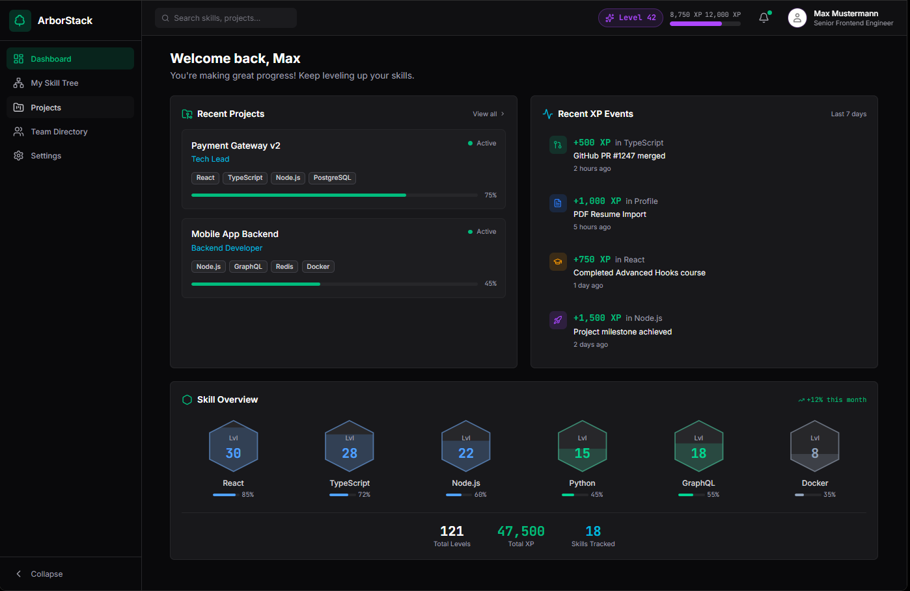
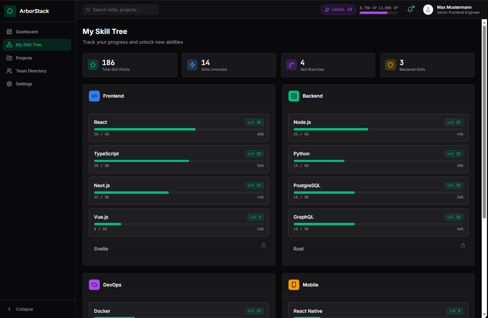
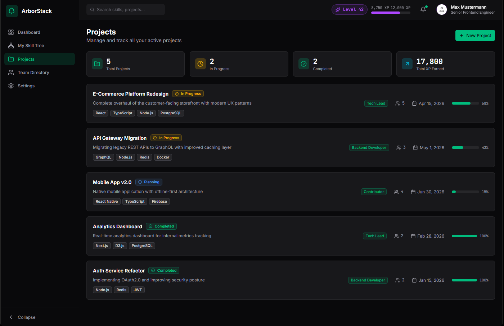
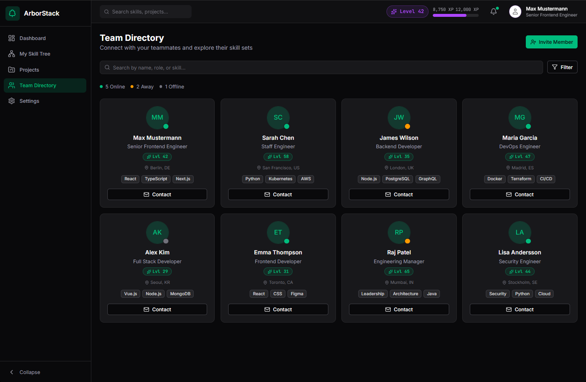
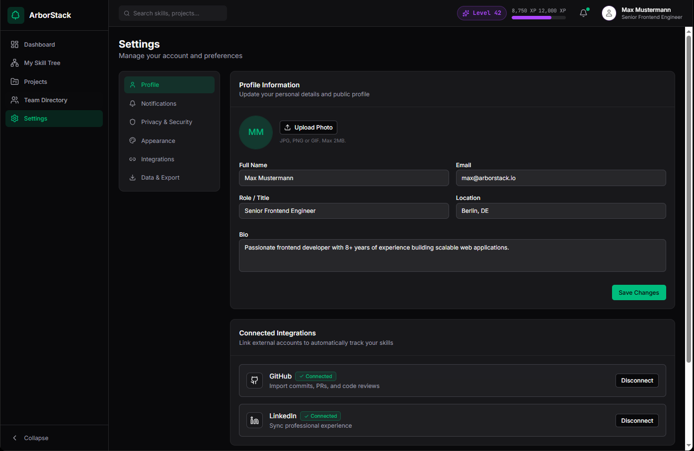

# 🖥️ ArborStack - UI/UX Showcase

This document presents the functional click-dummy of ArborStack and demonstrates how our "Enterprise-meets-Gaming" design system is applied in practice.

## 1. The Main Dashboard
The control center for every employee. It combines current project assignments with an auditable "XP Log" and a quick overview of core competencies.

  

## 2. The Skill Tree (Progression)
This is where the `parent_skill_id` architecture becomes visible. Skills are divided into main categories (e.g., Frontend, Backend). The progress bars motivate users towards their next "Level Up".

  

## 3. Project Tracking & Roles
This is where our complex ER diagram comes into play: Projects are linked to specific user roles (e.g., Tech Lead, Contributor) and the utilized tech stack.

  

## 4. Team Directory (Player Cards)
The address book 2.0. Employees are showcased with gamification elements (level-tier colors) and their top skills, making it easy to quickly find internal experts.

  

## 5. Settings & Automation
The hub for profile management and essential OAuth integrations (GitHub, LinkedIn), which enable asynchronous XP allocation via webhooks.

  

